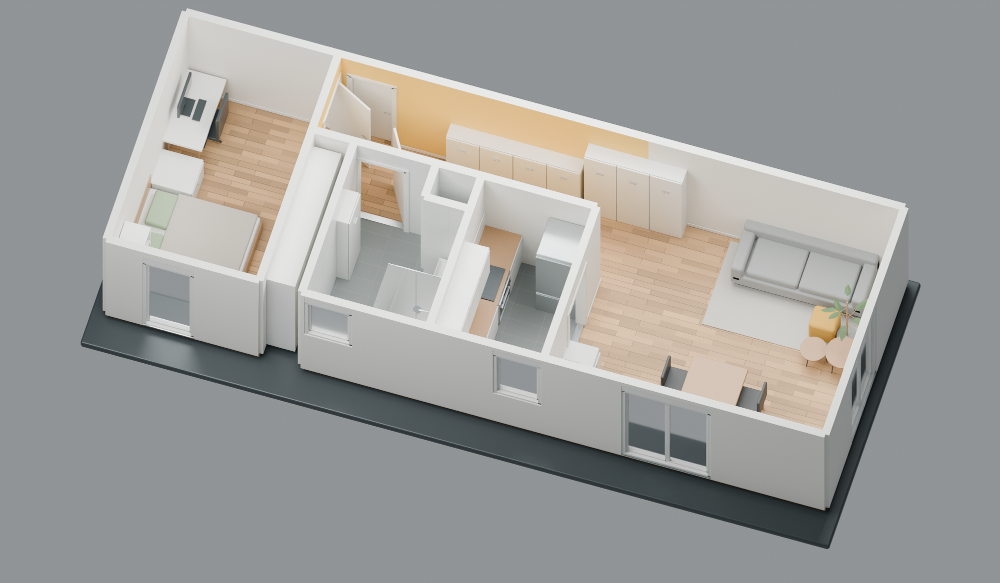
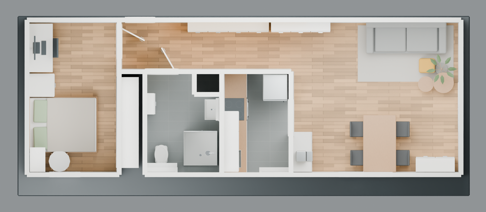

# ScanJu

An iOS 17+ LiDAR room, surface, and front TrueDepth close-up scanner. Built with SwiftUI, ARKit, RoomPlan,
SceneKit, and Core Image, without third-party dependencies or a backend.

**The public beta is ready.** [Install ScanJu with TestFlight](https://testflight.apple.com/join/jDMD2rmb)
on your iPhone or iPad. Version 1.0 (build 1) is approved for public beta testing.



A real **Complete** scan, rebuilt and refined by an agent in Blender using the
exported room geometry and camera images. The clean model includes simplified
furniture, photo-guided corrections, and some estimated dimensions. This render
shows the reconstruction made after export.

<details>
<summary>View the top-down room plan</summary>



</details>

## Recreate a scanned room with an agent

### Install the reconstruction skill

The [ScanJu room-reconstruction skill](skills/scanju-room-reconstruction/SKILL.md)
packages the workflow used for the room above: clean editable architecture,
photo-checked windows and recessed furniture, a matching texture-overlay scene,
floor-plan renders, and portable Blender/GLB delivery.

Install it from this repository using [skills.sh](https://skills.sh/docs):

```sh
npx skills add julianfbeck/ScanJu --skill scanju-room-reconstruction
```

Choose your agent in the installer. For a project-local Codex install, use
`--agent codex`; add `--global` if you want it available across projects. You need
Node.js/npm for the installer, Blender with Python for modeling, and Python 3.10+
for the included export inspector. An available Blender MCP connection lets the
agent work interactively; Blender Python scripts can also run locally in the
background. The skill does not set up the MCP connection for you.

Give the agent your **own** ScanJu Complete export and an output directory, then
invoke it (Codex example):

```text
Use $scanju-room-reconstruction on /path/to/ScanJu.zip.
Rebuild my room like the README example, using Blender MCP if available.
Save the clean and photo-overlay scenes, packed room.blend, GLBs,
floor plan, cutaway renders, and verification report in /path/to/output.
```

The skill includes coordinate/calibration guidance, the photo-audit lessons from
the original reconstruction, and a metadata inspector that accepts ZIPs or
extracted captures without loading the large media files. It uses your scan's
layout; the example apartment's private source data is not included. Modeling and
photo review are agent-assisted, so results depend on capture coverage and tools.

### Use the standalone prompt

Scan in **Complete** mode, export the ZIP, and give the export to your agent with
the prompt below. The SVG/DXF plan records detected walls and openings; the mesh
and camera textures provide the observed surfaces and appearance. A complete room
needs views of its boundaries. Measurements are estimates, and missing areas need
to stay explicit.

<details>
<summary>Copy the room-recreation prompt</summary>

```text
Recreate my scanned room as an editable Blender project, in the style of the
ScanJu README example. Use Blender MCP if available. Inspect the ScanJu export
I provide and read its README before modeling.

Use Room.json and FloorPlan.svg/FloorPlan.dxf for detected walls, doors, windows,
and openings. Use Mesh.obj with Mesh.mtl and frames/*.jpg, or TexturedMesh.usdz,
as the reference for observed surfaces and textures. Preserve the source scale
in meters and account for ARKit's right-handed, Y-up coordinates when importing
into Blender. Do not mirror the room or change its proportions.

Rebuild clean walls with real door and window openings, separate frames and
glazing, and simplified furniture based on the detected object boxes and photos.
Check ambiguous detections against calibrated camera views. Keep the measured
layout as the starting point; record any photo-guided correction, straightening,
or inferred furniture depth. Preserve opening positions and widths. Omit ceilings,
curtains, and temporary clutter so the room is readable as a cutaway model.

Create two scenes sharing the same corrected geometry: a clean model with simple
materials, and a photo-texture overlay for comparison. Keep furniture and room
elements separately editable. Preserve the original wall segments in a hidden
reference collection. Keep unseen surfaces neutral and identify gaps, conflicting
measurements, and assumptions. Do not invent hidden rooms or unobserved details.
If I provide only a 2D plan, ask for missing heights before making a full 3D room.

Deliver room.blend with packed textures, a GLB for each scene, a top-down
floor-plan PNG, and a softly lit three-quarter cutaway render of the clean scene.
Check scale, wall lengths, opening positions, and wall intersections against the
source and report discrepancies and unverified measurements. Keep the editing
viewport responsive; render previews separately if needed.
Keep the original export unchanged and keep camera images and raw scan data
local unless I explicitly request publication.
```

</details>

## Install and run locally

Use a Mac with full Xcode 16 or later, the iOS SDK, and an installed iOS 17+
Simulator runtime. Use an Xcode version that supports your physical phone's iOS
version for device testing. The public-source setup was verified with Xcode 27.0,
XcodeGen 2.46.0, and XcodeBuildMCP 2.7.0.

```sh
git clone https://github.com/julianfbeck/ScanJu.git
cd ScanJu
open ScanJu.xcodeproj
```

In Xcode select the **ScanJu** scheme and an installed iPhone simulator, then
**Product → Run** (⌘R). **Product → Test** (⌘U) runs the unit tests. The simulator
supports the library, UI, and synthetic geometry/export tests; actual LiDAR,
TrueDepth, and room scanning require a physical device. Unsupported capture modes
are disabled, so an inactive scan button on the simulator is expected.

The shared Xcode project is included. There are no packages to resolve, API keys,
server processes, or accounts required for simulator development. Agents should
read [AGENTS.md](AGENTS.md) for the code map and capture/recovery constraints.

### Command-line and agent setup

Install [XcodeGen](https://github.com/yonaskolb/XcodeGen#installing) to regenerate
the project and [XcodeBuildMCP 2.7.0](https://github.com/getsentry/XcodeBuildMCP/tree/v2.7.0)
for the tested build/run/test commands below. The npm install requires Node.js 18+.
Open Xcode once to finish installing its components and select the intended Xcode
in **Settings → Locations → Command Line Tools**.

```sh
brew install xcodegen
npm install -g xcodebuildmcp@2.7.0
xcodegen generate
xcodebuildmcp simulator list
```

Choose an available simulator's ID from that output and set it locally:

```sh
export SCANJU_SIMULATOR_ID='PASTE_SIMULATOR_ID_HERE'
xcodebuildmcp simulator build-and-run \
  --project-path "$PWD/ScanJu.xcodeproj" --scheme ScanJu \
  --simulator-id "$SCANJU_SIMULATOR_ID" \
  --derived-data-path "$PWD/build-simulator"
xcodebuildmcp simulator test \
  --project-path "$PWD/ScanJu.xcodeproj" --scheme ScanJu \
  --simulator-id "$SCANJU_SIMULATOR_ID" \
  --derived-data-path "$PWD/build-simulator"
```

With the MCP integration, call `session_show_defaults`, set the project, scheme,
and selected simulator via `session_set_defaults`, then use `build_run_sim` and
`test_sim`. Do not assume another agent's session points at this checkout.

### Run on your iPhone or iPad

Complete and Surface require rear LiDAR, available on supported iPhone Pro and
iPad Pro devices. Close-up requires front TrueDepth plus ARKit world tracking.
The deployment target is iOS/iPadOS 17.0. Scanning also needs Camera permission.

1. Connect, trust, and unlock your device; enable Developer Mode when iOS requests it.
2. Add your Apple account in Xcode. Select the ScanJu app target, then
   **Signing & Capabilities → Team**, choose your team, and leave automatic signing on.
3. For a personal build, choose your own unique bundle identifier. The checked-in
   `com.julianbeck.ScanJu` identifier and signing team belong to the maintainer.
4. Select the physical device and run. A personal bundle identifier installs a
   separate app with its own scan library. Keep existing scans when updating an app.

For settings that survive `xcodegen generate`, edit your local `project.yml`:
set `settings.base.DEVELOPMENT_TEAM` to your team, set
`options.bundleIdPrefix` to your reverse-DNS prefix, and set
`targets.ScanJu.settings.base.PRODUCT_BUNDLE_IDENTIFIER` to your unique app ID.
Regenerate afterward and keep personal signing changes out of contributions.

For agents, discover the attached device with `xcodebuildmcp device list` and use
its ID after signing is configured:

```sh
export SCANJU_DEVICE_ID='PASTE_DEVICE_ID_HERE'
xcodebuildmcp device build-and-run \
  --project-path "$PWD/ScanJu.xcodeproj" --scheme ScanJu \
  --device-id "$SCANJU_DEVICE_ID" --derived-data-path "$PWD/build" \
  --extra-args=-allowProvisioningUpdates
```

Optional UI automation uses an **already running** WebDriverAgent/RepDrive session.
`Tools/device_test.py` uses Python 3's standard library and never starts or restarts
the runner. Obtain the endpoint from your own session; use localhost below only
if your session is already forwarded there. Set `SCANJU_BUNDLE_ID` if using a
personal app identifier.

```sh
export SCANJU_WDA_URL='http://127.0.0.1:8100'
export SCANJU_BUNDLE_ID='com.julianbeck.ScanJu'
python3 Tools/device_test.py status
python3 Tools/device_test.py launch
python3 Tools/device_test.py tree
python3 Tools/device_test.py shot library
```

Use `--help` for supported interactions. Screenshots go into ignored
`DeviceEvidence/`. Capture only a permitted test subject; preserve the phone's
existing scans. The Delete all scans action permanently removes that app's data.

## Capture

- **Complete + Detail is the default.** Detailed LiDAR mesh, color points,
  high-resolution camera textures, and available room/floor-plan data are captured
  together. Mesh and textures are always enabled.
- **Complete** combines RoomPlan walls, openings, and floors with ARKit scene geometry.
- **Surface** captures partial areas, ceilings, and furniture without requiring a room.
- **Close-up** uses the front TrueDepth depth sensor and color camera for stationary
  small objects, with rear-camera world tracking. Face the screen side toward the
  object, ideally 20–60 cm away, and move the phone slowly. Keep the rear camera clear.
  Detail uses a 1.5 mm fusion grid and every valid depth pixel; Balanced uses 3 mm
  and samples every second pixel. Mesh generation uses neighboring depth samples
  (every second pixel in Detail), rejects depth edges, and retains the best observed
  patch per spatial tile and normal direction. This creates observed surfaces with
  possible seams and holes, not a watertight object. Sampling settings are not
  guaranteed measurement accuracy. This mode does not generate a floor plan.
- **Coverage** displays a solid turquoise mesh with a dark triangle grid. Camera
  gaps show where geometry has not been reconstructed. The center marker reports
  whether the aimed-at surface has mesh coverage; a nearer, unmeshed foreground
  surface is not counted as coverage of a previously captured wall behind it.
  Depth testing keeps nearer surfaces in front. Switch to **Wireframe** or **Camera**
  during capture; all capture channels remain enabled in every view.
- **Detail** requests ARKit's recommended 4K video format when available and uses an
  8 mm fusion grid. **Balanced** uses a 15 mm grid. These are fusion settings, not
  sensor-accuracy claims.
- Native, synchronized camera JPEGs, scene-depth maps, confidence maps, intrinsics,
  and camera poses are retained. Points use high-confidence depth and stable tracking.
- Points are fused into persistent voxel tiles with a bounded RAM cache. There is
  no fixed duration, point-count, or camera-keyframe ceiling. Memory warnings flush
  caches without ending capture. ScanJu stops near full storage (150 MB reserve
  for checkpoints); starting a scan requires 600 MB free. iOS can still interrupt
  the camera or terminate an app under resource pressure. Move around for coverage.
  If RoomPlan ends independently, detailed mesh and RGB-D capture continue with
  the last floor plan retained.
- Mesh anchors are saved atomically as they change; point tiles and capture metadata
  are checkpointed every two seconds. Each camera/depth/confidence set is saved
  with calibration during capture. **Finish saved scan** restores an interrupted
  capture or completes an interrupted ZIP without recording again. The most recent
  observations since the last checkpoint may be missing.
- Processing shows stage and percentage progress. ZIP/ USDZ packaging streams data
  with per-chunk memory release; mesh preview streams OBJ and decodes thumbnail
  textures within a 16-million-pixel budget. Exports keep original textures.
- **Delete all scans** at the bottom of the library removes completed captures,
  interrupted checkpoints, camera data, and exports after confirmation.

## Output

| File | Contents |
| --- | --- |
| `ScanJu.zip` | Complete transferable capture |
| `Mesh.obj`, `Mesh.mtl`, `frames/*.jpg` | Calibrated, depth-checked camera textures on the reconstructed mesh |
| `TexturedMesh.usdz` | Portable model with the original camera JPEGs, packaged with 64-byte alignment |
| `Mesh.usda` | OpenUSD mesh with calibrated UVs and Preview Surface materials |
| `PointCloud.ply` | Binary little-endian XYZ float32 + RGB uint8 |
| `Room.usdz`, `Room.json` | RoomPlan parametric model and semantic data, when detected |
| `FloorPlan.svg`, `FloorPlan.dxf` | Measured wall/opening drawing and CAD linework, in meters |
| `cameras.json`, `frames/*.depth`, `frames/*.confidence` | Reusable calibrated RGB-D source data |

All 3D coordinates use ARKit's right-handed, Y-up world space, in meters. Matrices
are column-major. Depth buffers contain tightly packed little-endian float32 meters;
confidence buffers contain one uint8 per pixel. Rear captures use ARConfidenceLevel
(0 low, 1 medium, 2 high). TrueDepth uses validDepthMask (0 invalid, 1 valid),
identified in cameras.json; it does not provide LiDAR confidence. TrueDepth exports
AVCameraCalibrationData intrinsics, radial distortion lookup tables and reference
dimensions, plus the depth filtering flag. Raw depth is rectified for unprojection
and optical distortion is applied for texture UVs. Face landmarks and expressions
are ignored; this mode does not use Face ID authentication. Intrinsics refer to native camera
JPEG dimensions and must be scaled to the depth resolution. Textureless faces remain
neutral instead of receiving a made-up texture. The generated export README documents
the full conventions and any capture warnings.
The interactive preview bounds decoded texture memory; exported texture images keep
their original resolution. USDZ is streamed directly from the USD mesh and JPEGs.

Scans are processed on-device. Share with AirDrop or Save to Files. File sharing also
exposes `On My iPhone > ScanJu > Scans`. Incomplete RoomPlan results do not discard
the detailed surface capture. Dimensions are estimates and need verification before
construction work.

## Verification

Run the **ScanJuTests** test action for calibration, negative voxel coordinates,
concave polygon area, binary PLY round trips, ZIP CRC/directory structure, and
texture-occlusion rejection. Simulator testing covers math and formats; real depth
capture requires hardware.
Tests also import textured USDZ back into SceneKit and verify ZIP entry alignment.
Recovery tests restore saved geometry after interruption, repair an unfinished ZIP,
check monotonic progress and atomic replacement, and export/reopen 1,048,577 points.
Complete ZIP exports switch to ZIP64 for large files, offsets, or entry counts.
USDZ retains its format limits; OBJ/MTL, PLY, camera data, and the complete ZIP
remain available if USDZ cannot be generated. Source files stay in Files if
processing or packaging runs out of storage.

See [TESTING.md](TESTING.md) for recorded automated and real-device results and
the remaining hardware validation limits. Keep room captures, device screenshots,
signing material, and generated archives out of Git.

## TestFlight

[Install the public beta](https://testflight.apple.com/join/jDMD2rmb).
Version 1.0 (build 1) is approved and available to external testers. See
[release preparation](Release/README.md) for the dated distribution status and beta
copy. Signed archives, IPA files, crash symbols, and account-specific validation
receipts are retained privately by the maintainer and excluded from this repository.
The app includes privacy information in Scanning guide → Your data → Privacy and
contact, plus a privacy manifest declaring the disk-space check used before capture.

## Design references

Apple documents how a [custom ARSession combines RoomPlan with scene geometry](https://developer.apple.com/videos/play/wwdc2023/10192/).
This app uses that shared-session arrangement so room measurements, points, mesh,
and photos occupy the same world coordinate system.

The Close-up mode uses Apple’s [raw captured depth data](https://developer.apple.com/documentation/arkit/arframe/captureddepthdata),
[face configuration with world tracking](https://developer.apple.com/documentation/arkit/arfacetrackingconfiguration),
and [optical depth calibration](https://developer.apple.com/documentation/avfoundation/avcameracalibrationdata).
It requires a physical TrueDepth camera and world-tracking support, rather than
relying on face-tracking availability alone.
